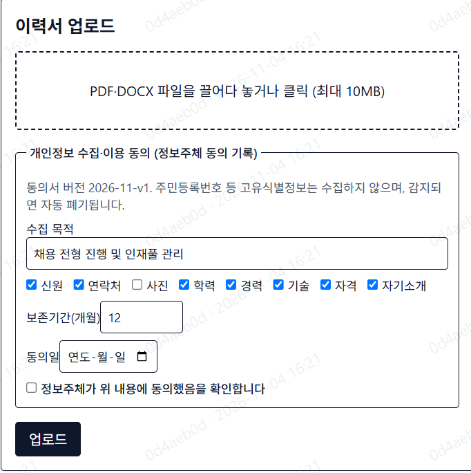
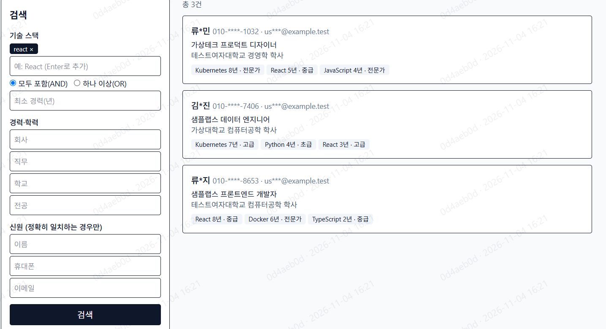

# resume-service

정형 양식 이력서(PDF/DOCX)에서 정보를 추출해 **암호화 저장**하고, 권한 있는 사용자만 필요한 정보를 검색·조회하는 내부용 서비스입니다.
개인정보를 다루므로 보안을 기능보다 우선했습니다.

```
브라우저 ──▶ web (Next.js) ──▶ api (FastAPI) ──▶ PostgreSQL (암호문만 저장, RLS)
                                                    ▲
                        worker ──▶ ClamAV(악성코드 검사)
                          └─▶ 격리 샌드박스에서 이력서 분석
```

## 화면

모든 화면의 데이터는 [samples/](samples/)의 합성(가짜) 이력서입니다. 비스듬한 워터마크는 **로그인한 사용자 ID 앞 8자리와 조회 시각**으로, 화면이 캡처돼 유출되면 누가 언제 봤는지 추적할 수 있게 합니다.

**업로드 — 정보주체 동의 기록**



- 업로드할 때 수집 목적, 수집 항목, 보존 기간, 동의일을 함께 기록합니다. 동의를 확인하지 않으면 업로드할 수 없습니다.
- 동의 내용은 이력서별로 기록되어 정보주체 요청 때 확인할 수 있고, 보존 기간이 지나면 이력서가 자동으로 파기됩니다.
- 파일은 악성코드 검사를 통과한 뒤 격리된 샌드박스에서 분석됩니다. 주민등록번호는 감지되면 저장 전에 지웁니다.

**검색 — 역할별 마스킹**



- 기술 스택(AND/OR), 최소 경력, 회사·직무·학교·전공으로 검색합니다. 기술명은 표준화돼서 `react`, `리액트` 모두 `React`로 검색됩니다.
- 결과의 이름, 전화번호, 이메일은 **기본적으로 마스킹**됩니다(`류*민`, `010-****-1032`). 원문을 보려면 열람 사유를 입력해야 하고, 모든 열람은 감사 로그에 남습니다.
- 신원 검색(이름, 휴대폰, 이메일)은 **정확히 일치할 때만** 찾습니다. 부분 검색으로 개인정보를 훑어볼 수 없도록 암호화된 블라인드 인덱스를 씁니다.

## 실행 방법

필요한 것: **Docker Desktop** (Windows에서는 설치 중 WSL2 활성화와 재부팅이 필요할 수 있습니다), 휴대폰이나 브라우저용 **OTP 앱**(Google Authenticator, Chrome 확장 "Authenticator" 등)

### 1. 설정 파일(.env) 만들기

비밀값을 무작위로 채운 `.env`를 만듭니다. 아래 둘 중 하나를 실행하세요.

```bash
# Python이 설치돼 있다면
python scripts/make_env.py
```

```bash
# Python이 없다면 Docker로 (macOS/Linux, Windows PowerShell)
docker run --rm -v "${PWD}:/w" -w /w python:3.12-alpine python scripts/make_env.py
```

Windows **Git Bash**에서는 명령 앞에 `MSYS_NO_PATHCONV=1 `을 붙이고 `${PWD}`를 `$(pwd -W)`로 바꾸세요.

### 2. 서비스 실행

```bash
docker compose up --build -d
```

처음에는 이미지 빌드와 ClamAV 바이러스 DB 다운로드 때문에 **5~10분** 정도 걸립니다. `docker compose ps`에서 5개 서비스(web, api, worker, postgres, clamav)가 모두 `running`이면 준비된 것입니다.

### 3. 관리자 계정 만들기

```bash
docker compose run --rm api python -m app.cli create-admin
```

- **영문 입력 상태**에서 입력하세요. 한글 모드에서는 `a`가 `ㅁ`으로 들어갑니다.
- 이메일은 `admin@example.com`처럼 가짜 주소면 됩니다.
- 비밀번호는 **12자 이상**이어야 하고, 과거에 **유출된 적이 있는 비밀번호는 거절**됩니다(HIBP 검사). `blue-cat-desk-river-26`처럼 무관한 단어를 이어 붙이면 통과합니다.
- 입력해도 화면에 표시되지 않는 것이 정상입니다. `생성됨.`이 나오면 성공입니다.

### 4. 로그인

http://localhost:3000 에 접속합니다. 첫 로그인에서만 아래 과정이 강제됩니다.

1. 이메일과 비밀번호를 입력합니다.
2. **MFA 등록**: 화면에 나온 비밀키를 OTP 앱에 "수동 입력"으로 등록하고 6자리 코드를 입력합니다.
3. **복구 코드**: 한 번만 표시되니 따로 저장해 두세요(OTP 앱을 잃어버렸을 때 사용).
4. **비밀번호 변경**: 초기 비밀번호를 새 비밀번호로 바꿉니다.

이후에는 비밀번호와 6자리 코드만 입력하면 됩니다.

### 5. 기능 테스트

[samples/](samples/)에 **가짜 데이터로 만든 이력서 5개**가 있습니다. 실제 인물과 무관합니다.

| 파일 | 확인할 수 있는 것 |
|---|---|
| `dummy_resume_1~4` (PDF 2, DOCX 2) | 업로드 → 악성코드 검사 → 자동 추출 → 검수·확정 → 기술·경력 검색 |
| `dummy_resume_5_rrn.pdf` | 가짜 주민등록번호가 들어 있음 → **자동 삭제되고 경고만 남는지** |

모든 샘플에는 GPS 정보가 들어간 가짜 증명사진이 있습니다. 업로드 후 위치 정보(EXIF)가 제거되는지 확인할 수 있습니다.

추천 순서: 업로드 → 검수 화면에서 추출 결과 확인·확정 → 검색(예: `React`) → 상세 조회(개인정보는 마스킹, 원문 열람은 사유 입력 필요) → 관리자 화면에서 사용자 추가·감사 로그 확인

### 종료와 초기화

```bash
docker compose down        # 종료 (데이터 유지)
docker compose down -v     # 종료 + 모든 데이터 삭제 (처음부터 다시 시작)
```

## 문제 해결

| 증상 | 해결 |
|---|---|
| 로그인 시 `Internal Server Error` | 3000번 포트를 다른 프로그램(예: `npm run dev`)이 쓰고 있는지 확인하고 종료하세요. |
| `이메일 또는 비밀번호가 올바르지 않거나…` | 계정 생성 때 한글 입력 모드였을 수 있습니다. 영문 모드로 다른 이메일을 써서 다시 만드세요. 5회 실패하면 15분간 잠깁니다. |
| `docker: command not found` | Docker 설치 후 터미널(또는 VS Code)을 완전히 껐다 켜세요. |
| `the input device is not a TTY` (Git Bash) | 명령 앞에 `winpty `를 붙이세요. |
| 업로드 후 계속 대기 중 | ClamAV가 바이러스 DB를 내려받는 중입니다. 몇 분 기다리세요(검사 전에는 처리하지 않습니다). |

## 테스트 실행 (선택)

```bash
cd apps/api
python -m venv .venv && .venv/Scripts/pip install -r requirements-dev.txt   # macOS/Linux: .venv/bin/pip
.venv/Scripts/python -m pytest      # 실제 PostgreSQL에서 RLS·권한·암호화까지 검증 (임시 DB 자동 기동)
```

## 문서

| 문서 | 내용 |
|---|---|
| [docs/SECURITY.md](docs/SECURITY.md) | 보안 구현 현황, 파일 격리 구조, 백업·파기, 침해 사고 대응 |
| [docs/SECURITY_CHECKLIST.md](docs/SECURITY_CHECKLIST.md) | 수용 기준별 증빙, 모의 공격 결과, **남은 위험**(운영 배포 전 필요 작업) |
| [docs/DATA_MODEL.md](docs/DATA_MODEL.md) | 저장 방식, 봉투 암호화 키 구조, RLS 정책 |
| [docs/RESUME_FORM.md](docs/RESUME_FORM.md) | 지원하는 이력서 양식 규격 |
| [docs/DATA_SUBJECT_REQUESTS.md](docs/DATA_SUBJECT_REQUESTS.md) | 정보주체 열람·정정·삭제 처리 절차 |
| [docs/OPEN_QUESTIONS.md](docs/OPEN_QUESTIONS.md) | 결정 사항과 남은 질문 |

> 이 구성은 로컬 평가용입니다. 웹은 `127.0.0.1:3000`에만 열리고 API·DB는 외부에 노출되지 않습니다. 운영 배포에는 TLS, 클라우드 KMS, 백업 암호화 등이 추가로 필요합니다(SECURITY_CHECKLIST.md "남은 위험").
